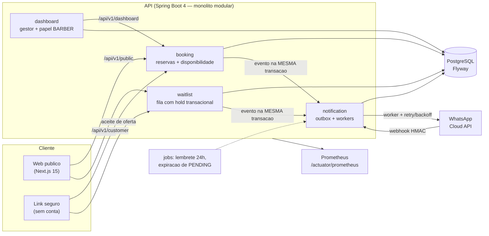

# BarberFlow

**Sistema completo de agendamento para barbearia**: reserva online com
disponibilidade calculada no servidor, lista de espera que recupera
horários perdidos, link seguro de gerenciamento sem conta e notificações
por **WhatsApp (Cloud API)** — tudo com LGPD desde a primeira linha.

[](https://github.com/mthlima13/barber/actions/workflows/ci.yml)


<!-- Screenshots: capture conforme docs/DEMO.md e descomente o bloco.
<p align="center">
  
  
  
</p>
-->



## Destaques técnicos (com o código)

| Desafio | Solução |
|---|---|
| Notificação nunca perde a reserva | **Outbox pattern**: evento gravado na MESMA transação do negócio, worker com retry/backoff até FAILED (`OutboxWorker.java`) |
| Replay do POST não duplica reserva | Idempotência por `Idempotency-Key` com unique no banco (`AppointmentAppService`) |
| WhatsApp fora da janela de 24h | Envio por **template da Meta** (corpo `{{1}}`, nomes derivados do evento — `docs/WHATSAPP.md`) |
| Lembrete nunca chega duas vezes | Job idempotente com chave única por reserva na outbox (`ReminderWorker`) |
| Vaga da fila não é vendida duas vezes | **Hold transacional**: oferta PENDING reserva o intervalo; aceite revalida o slot (`SlotValidator`, `WaitlistService`) |
| Cliente recebe lembrete de reserva que cancelou? | Worker **suprime** mensagens obsoletas → status `SKIPPED` com motivo no painel (`OutboxWorker`) |
| Brute force em rotas com token no caminho | Rate limit **antes do Spring Security**, por IP com janela deslizante (`RateLimitConfig`) |
| Privacidade real | Consentimento na coleta, acesso/exclusão do titular, anonimização irreversível, política versionada (`PrivacyService`) |
| Confiança de refatoração | **98 testes de integração** em PostgreSQL real (Testcontainers singleton + Flyway), CI no GitHub Actions |

<details>
<summary><strong>Funcionalidades</strong></summary>

- **Reserva pública** (`/b/{slug}`): serviço → profissional → horário
  (disponibilidade calculada no servidor) → dados; telefone com máscara BR
  normalizado para E.164; resumo antes de confirmar
- **"Avise-me"**: data cheia inscreve na lista de espera por horário
  específico; vaga aberta é ofertada **uma pessoa por vez** (hold de 5 min,
  expira e devolve ao próximo)
- **Link seguro** (`/reservas/{id}?t=...`): consulta, remarca e cancela sem
  conta; token único, no banco só o hash
- **Painel do gestor** (`/gestor`): agenda do dia com cartões-resumo
  (receita prevista, fila, outbox), CRUD de catálogo, fila com cliente
  resolvido, notificações (outbox), auditoria
- **Papel BARBER**: profissional vê e altera **apenas a própria agenda**;
  reserva de colega responde 404 e o CRUD do painel, 403
- **Lembrete 24h** e **expiração de PENDING** (job cancela pendente fora do
  prazo, libera o slot e oferta a fila)
- **Notificação ao gestor**: reserva nova, inscrição na fila, cancelamento
  e remarcação — pelo WhatsApp configurado no painel
- **LGPD**: política em `/privacidade`, exclusão do titular pelo link seguro
- **Observabilidade**: métricas de negócio no Prometheus (funil da fila,
  reservas por resultado, saúde da outbox) + p95/5xx do Spring

</details>

<details>
<summary><strong>Endpoints principais</strong></summary>

Publicos (rate limit por IP):
- `GET /api/v1/public/barbershops/{slug}` — dados da barbearia
- `GET /api/v1/public/barbershops/{slug}/services` e `/barbers`
- `GET /api/v1/public/barbershops/{slug}/availability?barberId=&serviceId=&date=`
- `POST /api/v1/public/appointments` — cria reserva (header `Idempotency-Key`)
- `POST /api/v1/public/waitlist` — inscricao na lista de espera

Titular do link seguro (`Authorization: Bearer <token>`):
- `GET/POST /api/v1/customer/appointments/{id}` e `/{id}/cancel`, `/{id}/reschedule`
- `GET|DELETE /api/v1/customer/appointments/{id}/privacy` — acesso/exclusao LGPD
- `GET|DELETE /api/v1/customer/waitlist/{id}` — inscricao e saida da fila
- `POST /api/v1/customer/offers/{token}/accept` — aceite da oferta de vaga

Dashboard do gestor (`MANAGER`) e agenda do profissional (`BARBER`):
- `POST /api/v1/auth/bootstrap` e `/auth/login`, `GET /api/v1/me`
- `CRUD /api/v1/dashboard/services` e `/barbers` (+ `/{id}/hours`,
  `/{id}/services`, `/{id}/exceptions`, `/{id}/credentials`)
- `GET /api/v1/dashboard/appointments?date=` + `PATCH /{id}/status`
- `GET /api/v1/dashboard/waitlist` + `POST /waitlist/process`
- `GET /api/v1/dashboard/outbox` e `GET /api/v1/dashboard/audit`
- `GET|PATCH /api/v1/dashboard/settings` — WhatsApp do gestor
- `GET /api/v1/dashboard/barber/agenda?date=` + `PATCH .../appointments/{id}/status` (BARBER)

Webhooks e operacao:
- `GET|POST /api/v1/webhooks/whatsapp` — challenge e eventos da Meta (HMAC)
- `GET /actuator/health`, `GET /actuator/prometheus`

</details>

## Rodar em 5 minutos

```bash
docker compose -f infra/compose.yaml up --build
```

- Web: http://localhost:3000
- API: http://localhost:8081 (health: `GET /actuator/health`)

Crie o primeiro gestor (cria a barbearia piloto):

```bash
curl -X POST http://localhost:8081/api/v1/auth/bootstrap \
  -H "Content-Type: application/json" \
  -d '{"name":"Gestor","email":"gestor@barbearia.local","password":"senha-segura-123"}'
```

No painel (`/gestor`), cadastre serviços e profissionais, libere o
expediente — e o fluxo completo está de pé. Desenvolvimento sem Docker e
demais variáveis: `.env.example`.

### Testes

```bash
cd apps/api
mvn verify   # 98 testes de integracao (Testcontainers; requer Docker)
```

### Métricas

`GET /actuator/prometheus` expõe, além das padrão do Spring:

- `barberflow_appointments_total{outcome="created|cancelled|conflict"}`
- `barberflow_waitlist_offers_total`, `..._accepted_total`, `..._expired_total`
- `barberflow_whatsapp_delivery_failed_total`
- `barberflow_outbox_pending`, `barberflow_outbox_oldest_pending_seconds`

## Estrutura

```
barberflow/
├── apps/
│   ├── api/            # Spring Boot 4 (monolito modular: booking, waitlist,
│   │                   # notification, availability, auth, audit, privacy...)
│   └── web/            # Next.js 15 (App Router, TypeScript, Tailwind)
├── infra/
│   └── compose.yaml    # Compose de desenvolvimento (PostgreSQL + API + Web)
├── docs/               # PRODUCAO.md, PILOTO.md, WHATSAPP.md
└── scripts/            # smoke.sh e e2e.sh (verificacao pos-deploy)
```

## Roadmap

- [x] Fase 0-2 — Fundacao, cadastro/agenda, agendamentos publicos (idempotencia, rate limit, outbox)
- [x] Fase 3 — Lista de espera com hold transacional e ofertas com expiracao
- [x] Web — Reserva publica, avise-me e link seguro de gerenciamento
- [x] Fase 4 — WhatsApp (Cloud API): worker, webhook da Meta e templates
- [x] LGPD — Consentimento, acesso/exclusao do titular, retencao configuravel
- [x] Fase 5 (preparacao) — Headers de seguranca, perfil `prod` fail-fast, smoke/E2E, CI
- [x] Lembrete 24h, expiracao de PENDING e notificacao completa ao gestor
- [x] Piloto documentado — `docs/PILOTO.md` + template de feedback de produto
- [ ] Deploy real (quando houver infra) — checklist pronto em `docs/PRODUCAO.md`

## Docs

- [`BARBERFLOW_ARQUITETURA.md`](BARBERFLOW_ARQUITETURA.md) — especificacao completa (o guia seguido de ponta a ponta)
- [`docs/PRODUCAO.md`](docs/PRODUCAO.md) — checklist de producao e pos-deploy
- [`docs/WHATSAPP.md`](docs/WHATSAPP.md) — credenciais e templates da Meta
- [`docs/PILOTO.md`](docs/PILOTO.md) — roteiro do piloto e metricas de sucesso
